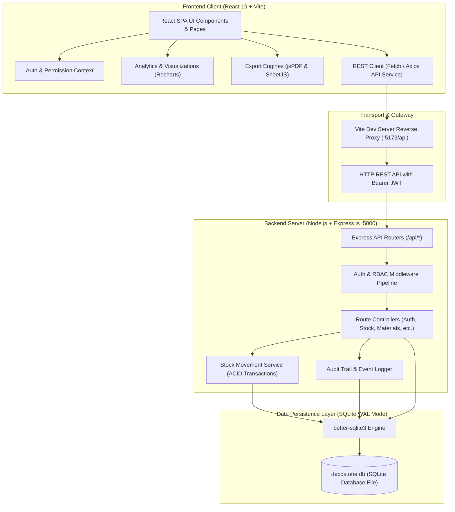

# PROJECT OVERVIEW: DecoStone Material Management System (MMS)

---

## 1. Project Overview

### 1.1 Project Name
**DecoStone Material Management System (MMS)**

### 1.2 Purpose & Vision
DecoStone MMS is a centralized, role-governed inventory and supply chain management web application built specifically for distributors and suppliers of architectural stone, tiles, marble, granite, kitchen sinks, and sanitary ware. The platform coordinates daily operations across four independent distribution warehouses (**Godown 1 to 4**), maintaining accurate, real-time stock levels, enforcing transactional integrity, and logging an immutable audit ledger of all material movements.

### 1.3 Problem Statement & Solution

| Traditional Industry Challenge | DecoStone MMS Implementation Solution |
|---|---|
| **Fragmented Multi-Warehouse Tracking**: Stock split across separate sites without unified visibility. | **Centralized Multi-Godown Dashboard**: Live, synchronized inventory ledgers across all four godowns with status indicators (In Stock, Low Stock, Out of Stock). |
| **Negative Stock & Phantom Inventory**: Manual paperwork allows dispatching items that do not exist physically. | **Database-Level ACID & Non-Negative Guards**: Stock mutations run inside atomic transactions; negative balances are blocked by SQLite `CHECK (quantity >= 0)` constraints. |
| **Untracked Inter-Warehouse Transfers**: Relocating materials between godowns often leads to double counts or loss. | **Atomic Two-Phase Transfer Engine**: Simultaneous source deduction and destination increment with unique tracking codes (`TRF-YYYY-NNNN`). |
| **Weak Access Controls**: Supervisors share admin accounts or perform unrestricted dispatches. | **Granular 3-Tier RBAC**: Express middleware enforces strict role access (Admin, Manager, Supervisor) and godown-level isolation. |
| **Procurement Lags & Stockouts**: Shortages are noticed only after customer orders fail. | **Dynamic Low Stock Warning Center**: Automatic threshold monitoring triggers replenishment alerts when stock reaches safety minimums. |
| **Slow Decision-Making**: Generating management reports requires manual spreadsheet consolidation. | **Integrated Export Hub**: Direct client-side generation of styled **PDF** reports and **Excel (.xlsx)** workbooks. |

---

## 2. Technology Stack

The project utilizes a decoupled **Client-Server REST Architecture** built with modern JavaScript runtimes, libraries, and embedded database tooling.

| Layer | Technology | Version / Package | Primary Role in System |
|---|---|---|---|
| **Frontend Framework** | **React** | `19.2.8` | Component-based Single Page Application (SPA), custom hooks, Context API |
| **Build Tooling & Dev Server** | **Vite** | `8.3.0` | Ultra-fast Hot Module Replacement (HMR), production bundling, API reverse proxy |
| **Styling & Design System** | **Vanilla CSS** | CSS3 Custom Properties | Stone-inspired dark/light theme, glassmorphism UI cards, responsive layouts |
| **Iconography** | **Lucide React** | `1.51.0` | Streamlined SVG icon system for UI controls and navigational elements |
| **Data Visualization** | **Recharts** | `3.10.1` | Interactive Donut (Godown share), Bar (Category breakdown), and Area charts |
| **Export Engines** | **jsPDF** & **SheetJS** | `jspdf` `4.2.1`, `xlsx` `0.18.5` | Client-side styled PDF generation (`jspdf-autotable`) and Excel spreadsheets |
| **Backend Runtime** | **Node.js** | `>= 18.0.0` | Server-side JavaScript execution environment |
| **Web Application Framework** | **Express.js** | `4.21.2` | RESTful API routing, JSON body parsing, custom middleware pipeline |
| **Authentication & Security** | **JWT & bcryptjs** | `jsonwebtoken` `9.0.2`, `bcryptjs` `2.4.3` | Password hashing (10 salt rounds), Bearer token generation, role verification |
| **Database Engine** | **SQLite** | `better-sqlite3` `11.8.1` | High-performance embedded ACID database with Write-Ahead Logging (WAL) |
| **File / Media Utilities** | **Multer & UUID** | `multer` `1.4.5`, `uuid` `11.0.5` | File upload handling and unique identifier generation |

> **Note on Database Configuration**: The primary runtime database is embedded SQLite (`backend/data/decostone.db`), delivering zero-configuration persistence and synchronous transactional operations via `better-sqlite3`.

---

## 3. Key Features & Modules

### 3.1 Executive Analytics & KPI Dashboard
- **Real-Time Inventory Metrics**: Calculates total active SKUs, total warehouse stock units, total inventory financial valuation, low-stock item counts, and today's inflow vs outflow volume.
- **Visual Analytics**: Interactive Recharts widgets displaying warehouse volume distribution, category-wise volume breakdown, and 7-day movement velocity trends.
- **Quick-Action Modals**: One-click launchers for immediate stock receipts, dispatches, and transfers directly from the home view.

### 3.2 Multi-Warehouse (Godown) Management
- **Dedicated Warehouse Dashboards**: Independent views for **Godown 1, Godown 2, Godown 3, and Godown 4**.
- **Real-Time Stock Status Badges**: Visual indicators for 🟢 *In Stock*, 🟠 *Low Stock*, and 🔴 *Out of Stock*.
- **Search & Multi-Filter**: Instant filtering across SKU, Brand, Category, and Inventory Status.
- **Warehouse Configuration**: Admin capability to manage godown names, operational codes, physical locations, and descriptions.

### 3.3 Category & Master Material Catalog
- **Hierarchical Classification**: Organized under categories such as *Tiles*, *Marble & Granite*, *Bathroom Ware*, *Kitchen Sinks*, and *Sanitary Ware*.
- **Comprehensive Item Master**: Captures SKU codes, product names, category relationships, brand names, units (Boxes, Sq.Ft, Pieces, Sets), dimensions, color, purchase prices, selling prices, and minimum reorder levels.
- **Soft-Deletion Protection**: Deleting materials sets `is_deleted = 1` rather than destroying records, maintaining historical transaction integrity.

### 3.4 Stock IN (Procurement & Receipts)
- Records inbound inventory batches with Supplier/Vendor name, Purchase Order (PO) reference numbers, and delivery remarks.
- Atomically increments targeted godown stock balance and writes a permanent ledger entry.

### 3.5 Stock OUT (Sales & Dispatches)
- Records dispatches to retail customers, contractors, or external commercial sites with Invoice/Reference numbers.
- **Hard Negative Stock Prevention**: Dispatches exceeding available quantities in the selected godown are rejected at the service and database levels.

### 3.6 Atomic Inter-Godown Transfers
- Relocates stock between any two warehouses (e.g., Godown 1 $\rightarrow$ Godown 3).
- **Two-Phase Atomic Execution**: Source deduction and destination increment happen in a single database transaction. If either phase encounters an error, both revert.
- **Conservation Invariant**: Total cross-warehouse inventory remains unchanged ($\Delta Q_{\text{source}} + \Delta Q_{\text{dest}} = 0$).
- Generates sequential, traceable transfer codes formatted as `TRF-YYYY-NNNN`.

### 3.7 Physical Stock Reconciliation & Adjustments
- Reconciles physical warehouse stock counts with system balances.
- Automatically calculates variances (+Surplus / -Deficit).
- Requires mandatory justification reasons (e.g., transit breakage, cutting/polishing loss, counting variance).

### 3.8 Low Stock Warning Center
- Live monitoring against configured minimum safety thresholds (`min_stock_level`).
- Filterable by godown and category with direct shortcuts to launch replenishment orders.

### 3.9 Reporting & Data Export Engine
- Comprehensive reports for godown distribution, category stock, and material movement histories.
- **Client-Side Export**:
  - **PDF Export**: Formatted, paginated reports with DecoStone corporate headers and timestamps via `jspdf-autotable`.
  - **Excel Export**: Clean spreadsheet workbooks (`.xlsx`) generated through SheetJS (`xlsx`).

### 3.10 User Administration & Security Audit Trail
- Multi-tier user management with granular permission toggles (`can_stock_in`, `can_stock_out`, `can_adjust`).
- Immutable system audit log recording User ID, action types, entity types, IP addresses, and timestamps.

---

## 4. User Roles & Permissions

The system implements a 3-tier Role-Based Access Control (RBAC) model. Permissions are enforced both on the client UI and at the backend Express middleware layer (`authenticateToken`, `requireRole`, `requirePermission`, `checkGodownAccess`).

| Capability / Module | Admin | Manager | Supervisor |
|---|:---:|:---:|:---:|
| **User Management** (Create, update, toggle active status) | ✅ Full Access | ❌ No Access | ❌ No Access |
| **System Settings & Godown Profiles** | ✅ Full Access | ❌ No Access | ❌ No Access |
| **Category Management** (Create, edit, delete) | ✅ Full Access | 👁️ View Only | ❌ No Access |
| **Material Catalog Management** (Add, edit) | ✅ Full Access | ✅ Full Access | ❌ No Access |
| **Material Soft Deletion** | ✅ Full Access | ❌ No Access | ❌ No Access |
| **Warehouse Stock Visibility** | ✅ All 4 Godowns | ✅ All 4 Godowns | 🔒 Assigned Godown Only |
| **Stock IN (Procurement Receipt)** | ✅ Yes | ✅ Yes | 🔒 Assigned Godown (if permitted) |
| **Stock OUT (Sales Dispatch)** | ✅ Yes | ✅ Yes | 🔒 Assigned Godown (if permitted) |
| **Inter-Godown Transfers** | ✅ Yes | ✅ Yes | 👁️ View Status Only |
| **Stock Reconciliation Adjustments** | ✅ Yes | 🔒 Requires `can_adjust` | ❌ No Access |
| **Low Stock Alert Center** | ✅ Yes | ✅ Yes | ❌ No Access |
| **Reports & Export Hub** (PDF & Excel) | ✅ Yes | ✅ Yes | ❌ No Access |
| **Security & System Audit Logs** | ✅ Yes | ❌ No Access | ❌ No Access |

### Role Descriptions
1. **Admin**: Executive owner or system administrator possessing unrestricted access across all warehouses, catalogs, settings, user accounts, and security audit logs.
2. **Manager**: Operational lead responsible for company-wide stock movements, transfers between godowns, catalog additions, and business performance reporting.
3. **Supervisor**: Warehouse-floor personnel restricted exclusively to their assigned godown (e.g., Godown 1). Supervisors can view stock balances and execute receipts or dispatches strictly within their assigned warehouse based on granular permission flags.

---

## 5. System Workflow

The following sequence describes the lifecycle of an end-to-end operation within DecoStone MMS:

```
[User Browser]
      │
      │ 1. Login (Credentials + Role Selection)
      ▼
[Express Auth Controller] ─── (Verify bcrypt hash & Role) ───► [SQLite DB]
      │
      │ 2. Return Signed JWT (Contains User ID, Role, Godown ID)
      ▼
[React App State] (Stores token in localStorage, initializes AuthContext)
      │
      │ 3. Stock Operation (e.g., Stock OUT / Dispatch)
      ▼
[Express Stock Route]
      │
      ├──► Step 4A: authenticateToken Middleware (Validates JWT signature & active account)
      ├──► Step 4B: requirePermission Middleware (Validates can_stock_out flag)
      └──► Step 4C: checkGodownAccess Middleware (Blocks access outside assigned godown)
      │
      │ 5. Stock Service (ACID Transaction)
      ▼
[better-sqlite3 db.transaction]
      ├── 1. Read existing stock for (godown_id, material_id)
      ├── 2. Validate non-negative invariant: (current_stock - dispatch_qty) >= 0
      ├── 3. Execute UPDATE stock SET quantity = quantity - dispatch_qty
      ├── 4. Execute INSERT INTO stock_transactions (record previous & new stock)
      └── 5. Dispatch audit log via auditService.logAudit()
      │
      │ 6. Commit Transaction & Return JSON Response
      ▼
[Client Response Handler]
      ├── Notification Toast ("Stock dispatched successfully")
      ├── Global event sync (useStockSync triggers balance refresh)
      └── Live UI update across Godown Dashboards and Analytics Charts
```

---

## 6. Project Architecture

The system follows a tiered full-stack architecture separating client presentation, API routing and business logic, and transactional persistence:



---

## 7. Database Overview

The persistence layer consists of normalized relational tables in SQLite (`backend/data/decostone.db`), utilizing foreign key references, check constraints, and unique indexes to enforce data integrity.

| Table Name | Primary Purpose | Key Columns & Constraints |
|---|---|---|
| `godowns` | Stores physical warehouse locations and status | `id` (PK), `name` (Unique), `code`, `location`, `description`, `is_active` |
| `users` | Manages user credentials, roles, and granular permissions | `id` (PK), `name`, `username` (Unique), `email` (Unique), `password_hash`, `role` (Admin/Manager/Supervisor), `assigned_godown_id` (FK $\rightarrow$ godowns), `can_stock_in`, `can_stock_out`, `can_adjust`, `is_active` |
| `categories` | Categorizes materials into groups | `id` (PK), `name` (Unique), `description`, `image_url` |
| `materials` | Master catalog of materials and specifications | `id` (PK), `sku` (Unique), `name`, `category_id` (FK $\rightarrow$ categories), `brand`, `size`, `color`, `unit`, `purchase_price`, `selling_price`, `min_stock_level`, `is_deleted` (Soft delete flag) |
| `material_images` | Supports multiple secondary product images | `id` (PK), `material_id` (FK $\rightarrow$ materials ON DELETE CASCADE), `image_url`, `is_primary` |
| `stock` | Real-time inventory balance pivot table | `id` (PK), `godown_id` (FK $\rightarrow$ godowns), `material_id` (FK $\rightarrow$ materials), `quantity` (REAL, `CHECK (quantity >= 0)`), `UNIQUE(godown_id, material_id)` |
| `stock_transactions` | Immutable audit ledger of all stock movements | `id` (PK), `transaction_id`, `transaction_type` (STOCK_IN, STOCK_OUT, TRANSFER_IN, TRANSFER_OUT, ADJUSTMENT, OPENING_STOCK), `godown_id` (FK), `material_id` (FK), `quantity`, `previous_stock`, `new_stock`, `user_id` (FK), `reference_no`, `partner_name`, `reason` |
| `stock_transfers` | Inter-godown transfer records | `id` (PK), `transfer_id` (Unique, e.g., `TRF-2026-0001`), `from_godown_id` (FK), `to_godown_id` (FK), `material_id` (FK), `quantity` (`CHECK (quantity > 0)`), `reason`, `status`, `user_id` (FK) |
| `stock_adjustments` | Physical count reconciliation records | `id` (PK), `godown_id` (FK), `material_id` (FK), `system_stock`, `physical_stock`, `adjustment_quantity`, `reason`, `user_id` (FK) |
| `audit_logs` | Immutable operational and security audit log | `id` (PK), `user_id`, `user_name`, `role`, `action`, `details`, `ip_address`, `affected_table`, `affected_id`, `created_at` |
| `system_settings` | Key-value store for application configuration | `key` (PK), `value`, `description`, `updated_at` |

---

## 8. Setup and Execution

### 8.1 Prerequisites
- **Node.js**: Version `18.0.0` or higher
- **npm**: Version `9.0.0` or higher
- **Operating System**: Windows, macOS, or Linux

---

### 8.2 Installation & Startup Steps

The application requires running both the backend REST API server and the frontend development client.

#### Step 1: Start the Backend Server

1. Open a terminal and navigate to the `server` directory:
   ```bash
   cd backend
   ```
2. Install server dependencies:
   ```bash
   npm install
   ```
3. Start the API server:
   ```bash
   npm run dev
   ```
   *(Alternatively, run `npm start` for standard node execution).*

- The server will boot on port `5000` (`http://localhost:5000`).
- Database initialization and seeding run automatically on startup if the database is unpopulated.

#### Step 2: Start the Frontend Application

1. Open a second terminal and navigate to the `client` directory:
   ```bash
   cd frontend
   ```
2. Install client dependencies:
   ```bash
   npm install
   ```
3. Start the Vite development server:
   ```bash
   npm run dev
   ```
4. Access the web interface in your browser at `http://localhost:5173`.
   Requests sent to `/api/*` are automatically reverse-proxied to `http://localhost:5000`.

---

### 8.3 Demo User Credentials

The database comes pre-seeded with accounts for testing different role permissions. The login screen also features 1-click demo buttons:

| Role | Username | Password | Assigned Access Scope |
|---|---|---|---|
| **Admin** | `admin` | `admin123` | Complete enterprise access across all four godowns |
| **Manager** | `manager` | `manager123` | Operational access across all godowns (Stock, Transfers, Reports) |
| **Supervisor 1** | `supervisor1` | `supervisor123` | Isolated strictly to **Godown 1** (Receipt & Dispatch only) |
| **Supervisor 2** | `supervisor2` | `supervisor123` | Isolated strictly to **Godown 2** (Receipt & Dispatch only) |

---

### 8.4 Production Build (Optional)
To build the frontend bundle for production deployment:
```bash
cd frontend
npm run build
```
The optimized static build will be placed in `frontend/dist`.
